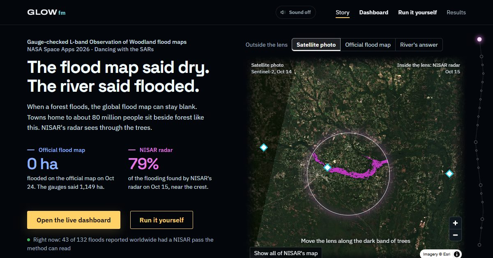

# Hidden Floods

**When a forest floods, the global flood map can stay blank.** Hidden Floods finds that water with NISAR's L-band radar, which reaches the ground under the trees, and grades every map against the river's own gauges and lidar. Built for NASA Space Apps 2026, *Dancing with the SARs*.



- **The gap is real:** on the Satilla in October 2026 the gauges pointed to 1,149 ha under water. The official map (Copernicus GFM) marked 0 ha. Its own mask leaves out 92% of floodplain under trees where we checked, and 2.4 million km² of the world's river floodplain is under trees.
- **NISAR sees it, sometimes:** with the method frozen before the flood's data was opened, NISAR found 79% of that flooding (CSI 0.73). On other rivers it failed, and every test is shown, failures included.
- **Anyone can check it:** the site runs the frozen method in your browser on this season's floods, puts a trust light on every map, and publishes paper-style figures with their data.

## See it

```bash
python scripts/serve_app.py      # then open http://127.0.0.1:8765
```

The site is static: everything is in `app/`, with no server code. Pages:

- **Story** (`index.html`): the finding, a scroll journey from orbit to one flooded tree, a game against the satellite, a flood through time, and a check for your town.
- **Results** (`evidence.html`): an abstract, nine numbered figures with captions computed from the data (each downloads as SVG, PNG or CSV), and every test in tables.
- **Run it yourself** (`live.html`): the frozen method on current floods, run in the browser.
- **Dashboard** (`dashboard.html`): live river levels, every pass and layer, and the worldwide blind-spot map.
- **Tour** (`tour.html`): the whole story in one minute.

## Results so far

**The blind spot is large.** On the audited floods, gauges and lidar estimate 832–17,972 ha of flooding, 88–99% of it under trees. Copernicus GFM mapped at most 0.75 ha of it, and its exclusion mask covers 97–99% of the estimated flooding. See `research/BLIND_SPOT_AUDIT.md`.

**NISAR helps on some floods and fails on others.** Each test below ran once, with the method frozen first:

| Test | Method | CSI |
|---|---|---|
| Pearl | v1 | 0.23 |
| Tangipahoa | v2 | 0.29 |
| Yellow, Oct 16 (the storm was also used in development) | v3 | 0.88 |
| Pine Island Bayou, Sep 7 | v3 | 0.71 |
| Village Creek, Sep 3 | v3 | 0.47 |
| Pee Dee | v4 | 0.10 |
| Neuse | v4 | 0.06 |
| Lower Sabine | v4 | 0.05 |
| **Satilla, Oct 15 (2 of 3 gauges above flood level)** | v4 | **0.73** |
| Satilla, Oct 19 | v4 | 0.72 |
| St Marys, Oct 7 | v4 | 0.58 |
| Ochlockonee, Oct 14 | v4 | 0.43 |

Five more passes in that last test couldn't be judged, four of them with an estimate of 0 ha on the Alapaha and Withlacoochee (`research/OVERBANK_RESULTS.md`).

**Known limits:**
- A lidar height cutoff with no radar scored about the same in the latest test (mean 0.61, against v4's 0.62), and higher on 10 of 15 earlier passes (`research/STATIC_BASELINE.md`). The estimate uses the same lidar, which favours it. Radar's clear addition is timing.
- With no lidar in the map, NISAR averaged 0.25 against 0.22 for a height map from a global elevation model, winning on 4 of 7 passes and losing on 2. The height map would average 0.31 at its best limit per pass, so the margin isn't robust (`research/NO_LIDAR_RESULTS.md`).
- Outside the US, the method hasn't transferred. At Tonle Sap in Cambodia, an unvalidated case, three of four predictions failed. A signal found afterwards looks promising but needs its own test (`research/TONLE_SAP_RESULTS.md`).
- A trust signal fixed in advance was right on 3 of 4 judgeable passes, too few for a verdict. A High confidence label reached 0.60 on only 2 of 4.
- Rain explains part of the failures, though not all of them (`research/RAINFALL.md`).
- The "truth" is an estimate from gauges and lidar, not a direct sighting of water under the trees. It is weakest on falling limbs, and it needs US gauges and lidar.
- With one gauge hidden, the others predicted its level within ±0.5 m only 27% of the time, with a 1.14 m median error over 37–91 km gaps (`research/HIDDEN_GAUGE.md`). Error near gauges is unmeasured.
- Requiring a connection to mapped reference water can hide flooding on narrow rivers (`research/OVERBANK_RESULTS.md`).
- Independent imagery only partly checks the estimate. On the Satilla, blind review of Sentinel-2 found flooding at 9 of 14 decidable estimate-wet points and 0 of 11 estimate-dry points, on open ground only (`research/INDEPENDENT_CHECK_RESULTS.md`). NOAA aerial photos of the lower Yellow couldn't separate water from shadow under canopy, and high-ground forest scored about the same as radar-flagged forest (`research/INDEPENDENT_AERIAL_RESULTS.md`). Water under closed canopy, and radar flags beyond the estimate's corridor, remain unverified. Unused tributary gauges could score only 3 of 14 gauge-and-pass pairs: one shows flags well above measured water on the Neuse, and one shows flags following a rising Withlacoochee (`research/TRIBUTARY_GAUGE_RESULTS.md`).
- River flow didn't confirm the estimate's water volumes. In a test with fixed rules, 0 of 8 judged reaches were consistent. A later check suggests the flow record was too noisy to decide, so this neither supports nor refutes the volumes, and some large floodplains may be overstated (`research/WATER_BUDGET_RESULTS.md`).

## Layout

- `app/`: the static web app, with a story page, a Results page, Run it yourself, a live dashboard and a one-minute tour. The dashboard's Blind spots tab and map layer show the worldwide blind-spot map (`research/BLIND_SPOT_ATLAS.md`). `app/README.md` explains how to run it.
- `src/hidden_floods/`: the package, with readers in `io/`, flood rules v1 to v4, the gauge-and-lidar estimate, metrics and the auditor.
- `scripts/`: every run behind a reported number. `run_frozen*.py` are the one-time tests, `dev_*.py` and `explore_*.py` are development, and `posthoc_*.py` are follow-up checks.
- `research/`: protocols, results and receipts. Start with `OVERBANK_RESULTS.md` and `BLIND_SPOT_AUDIT.md`.
- `brand/`: the team logo, the GLOWfm name over the story page's night-side globe, at 1024 and 2048 px.
- `sites/`: one settings file per river.
- `tests/`: synthetic unit tests and receipt checks.

**Frozen files:** the protocols, site files, frozen scripts and most of `src/hidden_floods/` are hashed in `research/freeze_receipt*.json`. Editing one breaks the record of what was tested. `outputs/` holds run records that the frozen scripts use to refuse a second attempt, so don't clear it.

## Setup

Large data stays outside the repository and outside OneDrive. Set `HIDDEN_FLOODS_DATA` to override the default `C:/Users/Jasmi/nisar-data`.

```bash
py -3.12 -m venv C:/Users/Jasmi/.venvs/hidden-floods
C:/Users/Jasmi/.venvs/hidden-floods/Scripts/python.exe -m pip install -e ".[dev]"
C:/Users/Jasmi/.venvs/hidden-floods/Scripts/python.exe -m pytest
```

NISAR, DSWx-S1 and IMERG downloads use an Earthdata login in `~/.netrc`, read only by curl.

## Flood-map auditor

Asks how much of the flooding estimated from USGS gauges and 3DEP lidar a given flood map showed at its own acquisition time. It uses no NISAR detector, so it works on any flood product.

```bash
hidden-floods create-site yellow 02367900 02368000 02369600 --start <date> --end <date>
hidden-floods fetch yellow 20261010 20261022
hidden-floods audit yellow 20261010 20261022
hidden-floods audit-raster yellow my_map.tif --time 2026-10-17T11:02:00Z --flood-values 1 3
```

**Settings:** ±0.5 m margin, dry labels only 0.5–5 m above the water, a 4 km valley corridor, connectivity to GFM reference water, pixels within 10 km of a gauge, and permanent water excluded. Intervals use a 2 km along-valley block bootstrap. The audit measures what a map missed, not its full accuracy.

## How it was made

Much of the code was written with AI assistance (Claude). Licensed under MIT; see `LICENSE`.
