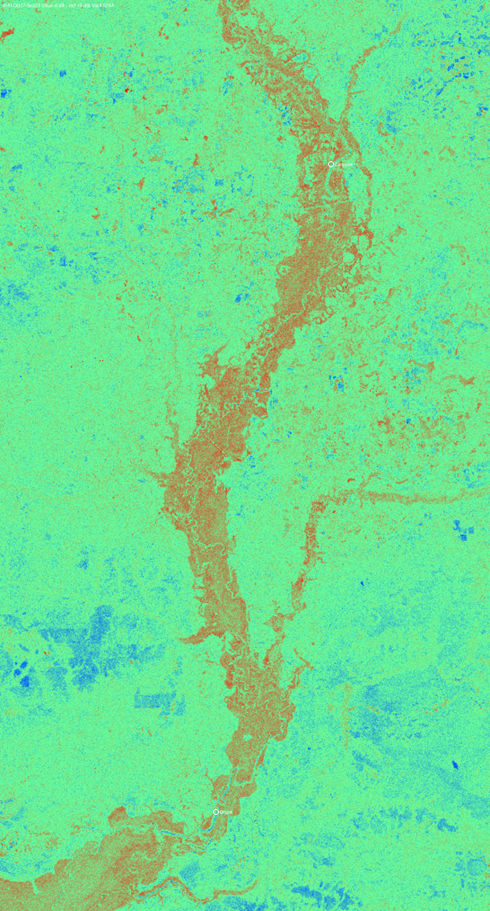
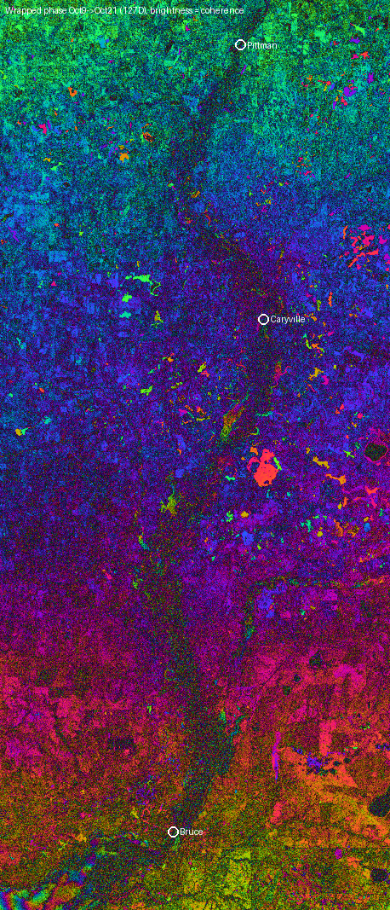
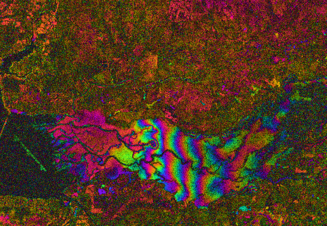
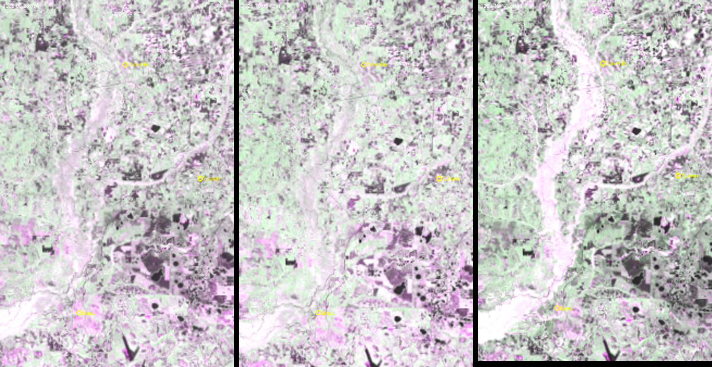
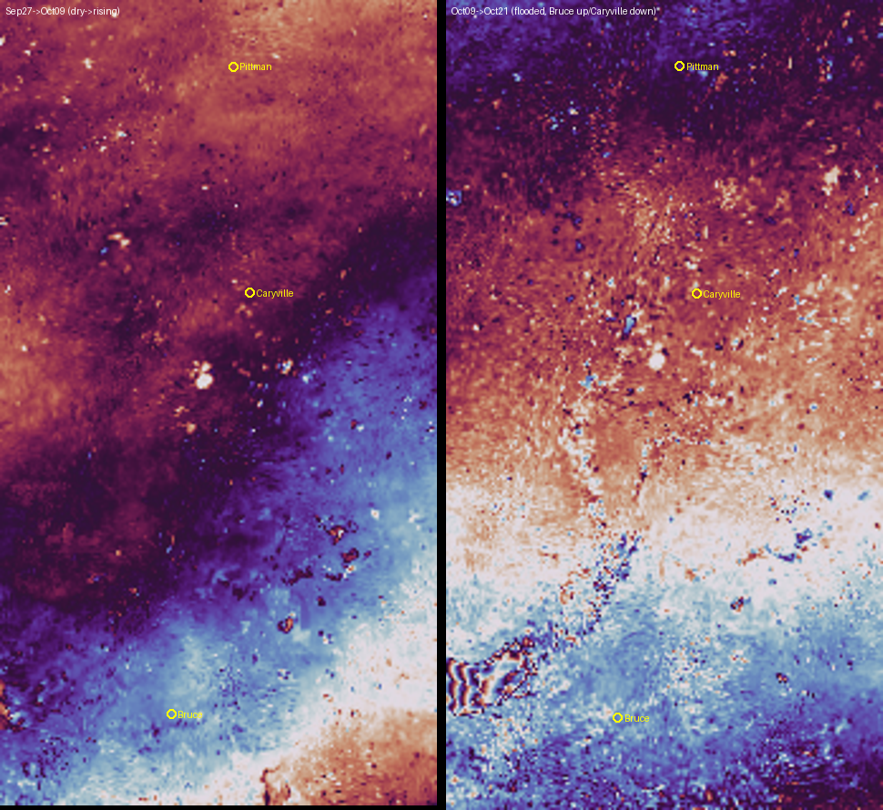

# Feasibility checks — results

> The `scratch/` scripts cited here were removed from the working tree after commit `0a9c3e8`, and they remain in git history.

## Full-data update (same day, Earthdata login)

Downloaded to `C:\Users\Jasmi\nisar-data\choctawhatchee\` (outside OneDrive, about 14.6 GB):
- GCOV 076A Sep 23 (dry) and Oct 17 (crest);
- GUNW 127D Oct 9→21.

The scripts are `scratch/f2_backscatter.py` and `scratch/f3_interferogram.py`. The Oct 17 scene is flagged `isUrgentObservation = True`, which suggests NISAR was urgently tasked for Isaias. This needs confirming before it is cited.

### F2 (quantitative) — PASS

Method: 5×5 multilook to 50 m; ΔHH and ΔHV in dB, Oct 17 minus Sep 23. Region: lon −86.02…−85.74, lat 30.40…30.86.
- **Candidate flooded forest** (dry HV > −16 dB, ΔHH > 3 dB, |ΔHV| < 2.5 dB, Δ(HH/HV) > 2.5 dB): **7,412 ha**.
  - Inside it: ΔHH median **+4.0 dB**, ΔHV **+0.6 dB**, Δ(HH/HV) **+3.4 dB**. That is the double-bounce signature: HH rises while HV barely moves.
- **The candidates sit along the river.** Share of forest flagged:
  - 0–2 km from a crude river line: 15.7%;
  - 2–5 km: 9.3%;
  - 5–10 km: 1.7%;
  - beyond 10 km: **0.6%**, a rough false-positive floor.
- **The map is a clean, continuous floodplain corridor** from above Caryville to the delta, plus the Holmes Creek tributary. The main channel itself goes *down* in HH, which is expected for open water. The rest of the landscape is near 0 dB.
- **Caveats:** thresholds are ad hoc. The "river line" is a hand-drawn polyline. There is no truth comparison yet. GCOV has a known `identification`-group QA FAIL flag; check what it means.

### F3 (quantitative) — PARTIAL PASS

Gauge stage change at the acquisition time (00:28 UTC), from USGS instantaneous values:

| Gauge | Change | Feet |
|---|---|---|
| Bruce | **+1.36 m** | 7.01 → 11.47 ft |
| Caryville | −0.53 m | 7.17 → 5.42 ft |
| Pittman | −0.91 m | — |
| Geneva | −0.79 m | — |

- **Upper and middle floodplain (Caryville to Bruce): not usable in this pair.**
  - Flooded-forest coherence has median **0.17** at 80 m and 0.27 at 20 m. Upland forest is 0.26 and 0.32.
  - The floodplain appears as a dark, decorrelated band. Water level and flood extent changed too much over 12 days.
  - Per-gauge phase tests failed for lack of coherent pixels.
- **Lower delta swamp (west of Bruce toward the bay): clear signal.**

  - The persistently flooded swamp stays coherent and shows **clean fringes confined to the floodplain**. They run across the direction of flow, and the upland around them is uniform.
  - Integrating phase along the swamp gives about **4.5–5.5 fringes, which is about 0.7–0.9 m of relative water-level change across about 8 km**. This uses 0.159 m per fringe at about 40.5° local incidence, and the result holds across three row bands.
  - **Hydraulically plausible:** +1.36 m at Bruce, about 10 km upstream, against a bay-controlled downstream end.
- **Not yet validated:**
  - no gauge sits inside the coherent zone;
  - the sign convention is unverified;
  - the bay-level change Oct 9→21 is unknown (check a NOAA station in Choctawhatchee Bay);
  - the phase-gradient integration could undercount aliased fringes.

### F3 follow-up: delta gauges, a control pair and an independent pair

**Gauges in the delta.**
- USGS's delta gauges (02366800, 02366810, the mouth stations) have no Oct 2026 data.
- The NWS NWPS API does list **FDEP-operated gauges**, with roughly 30 days of 6-minute data from Oct 4:
  - `CTBF1` Choctawhatchee River at Bunker (−86.088, 30.395, MHHW), at the downstream end of the fringe zone;
  - `WBLF1` Black Creek Landing (NAVD88), which has a gap at the Oct 21 acquisition;
  - bay gauges `PIPF1`, `FMCF1`, `HOGF1` and `LGBF1`;
  - `BRUF1` Bruce.
- Gauge pixels themselves sit on open channels (coherence ≈ 0.1–0.3), so phase is read from swamp pixels and **Bunker is used as the reference longitude**.

**SWOT.** There are passes over the delta (pixel cloud Oct 8, Oct 17, Oct 29), but none coincides with the NISAR pair dates, so SWOT isn't usable for this check.

**Three pairs, the same method** (`scratch/f3_profile.py`): 20 m wrapped phase, integrated west to east over coherent swamp, latitude 30.377–30.428. Values are water-level change relative to Bunker. The table's "Gauge Bruce − Bunker" column is the change at the gauges, about 19 km apart.

| Pair | Geometry | Swamp coherence | Gauge Bruce − Bunker | InSAR at −86.04 | InSAR at −86.02 | InSAR at −85.99 |
|---|---|---|---|---|---|---|
| Sep 15→27 (**control**, near-dry, Bruce falling) | 127D | 0.66 | about −0.3 m | −0.02 | −0.02 | **−0.06 m** |
| Oct 9→21 | 127D | 0.36 | +1.41 m | +0.30 | +0.54 | **+0.71 m** |
| Oct 5→17 (crest) | 076A, an independent geometry | 0.31 (coherent columns 37%) | +2.56 m | +0.30 | +0.52 | **+0.56 m** |

**Findings:**
1. **The control pair is flat** (−0.06 m, coherence 0.66). The fringes aren't processing or topography artifacts.
2. **Two independent pairs, ascending and descending on different dates, show the same spatial shape.**
   - The profile is flat west of −86.06, rises steeply from −86.06 to −86.02, then flattens.
   - Atmosphere wouldn't repeat across different dates and geometries, so the signal is hydrologic.
   - The sign convention (negative phase increment means rise) gives a rise in both, consistent with the gauges.
3. **Magnitude is only partly validated.**
   - Oct 9→21 gives +0.71 m at −85.99. Interpolating linearly between the Bunker and Bruce gauges predicts about +0.73 m, but that interpolation is an assumption, not an independent measurement.
   - The crest pair gives only +0.56 m where interpolation predicts about +1.3 m. Coherence is low (37% of columns usable), so phase integrated across gaps is lost. **This method underestimates large changes where coherence drops.**
   - The flattening east of −86.0 in both pairs may be the same gap effect, not real.
4. **Net:** the signal is real and in the right direction. Its magnitude is right in one pair and underestimated in another. No gauge sits inside the steep-gradient zone.
   - Expert-ready claim: "NISAR detects water-level change under swamp canopy, confirmed by a null control and by repeat geometry; magnitude agrees within about 0.1 m with gauge-bracketed expectation in one pair and is underestimated where coherence drops."
   - Next steps to strengthen it: 2-D phase unwrapping restricted to swamp (instead of 1-D column integration); the 127D Oct 21→Nov 2 pair, falling limb, once processed; and checking whether FDEP has more gauges inside the swamp (dashboard: fldep-stevens.com project 512).

### F5 — the blind-spot ledger check: PASS on area, weak on people

Data:
- Copernicus GFM via the public EODC STAC (`stac.eodc.eu`, collection `GFM`): ensemble flood extent, exclusion mask, reference water.
- OPERA DSWx-S1 WTR tiles from PO.DAAC.
- Both resampled (nearest) onto the NISAR 50 m grid. Script: `scratch/f5_ledger.py`.

**Timing.** The Sentinel-1D pass on Oct 17 (23:37 UTC) fell east of the river (valid data east of about −85.5°), so **there is no same-day operational map at the crest**. The fair match is **NISAR 127D Oct 21 00:28 UTC against Sentinel-1D Oct 22 23:45 UTC** (about 47 h apart, on the receding limb).

| Comparison | NISAR flooded forest | Inside GFM exclusion mask | GFM flood | DSWx-S1 inundated veg. / open water | Seen by neither |
|---|---|---|---|---|---|
| NISAR 127D Oct 21 vs S1 Oct 22 (**fair match**) | 3,111 ha | **97%** | **0 ha** | 29 / 5 ha | **3,073 ha (99%)** |
| NISAR 076A Oct 17 (crest) vs S1 Oct 22 (mask is near-static; flood columns not comparable) | 7,412 ha | **99%** | 0 ha | 44 / 1 ha | 7,361 ha |

Additional findings:
- **GFM mapped 0 ha of flooding anywhere in the study area on Oct 22.** Its exclusion mask covers **86%** of the area.
- DSWx-S1 flagged 873 ha of inundated vegetation in the area, but almost none of it overlaps NISAR's flooded forest. It sits in herbaceous-wetland areas, consistent with its WorldCover restriction.
- **This is exactly the structural blind spot the plan claims.** At this site it isn't a partial miss: the operational products saw essentially none of the forest flooding.

**Exposure** (OSM, bridges excluded; `scratch/f5_exposure.py`, Oct 17 crest mask):
- **About 15.5 km of drivable road** inside the hidden flood: residential 5.7 km, tracks 5.4 km, service 1.8 km, tertiary 1.3 km, primary/secondary/motorway about 1 km. The motorway pixels are probably embankment edges; verify them.
- **2 mapped buildings.** OSM building coverage in rural NW Florida may be incomplete, so check Microsoft or USA Structures footprints and GHSL/WorldPop population before quoting a people number.
- **Implication:** the lower Choctawhatchee floodplain is mostly uninhabited swamp forest. **Here the ledger's power is area (about 99% invisible), not people.**

**Caveats:**
- Candidate thresholds are ad hoc and not yet validated against truth.
- 47 h separate the passes on a receding flood.
- The GFM exclusion mask was taken from the Oct 22 scenes.
- The GFM terms of service require attribution.

### F4 — hydraulic truth under the canopy: PASS

**Data**
- **Lidar:** USGS 3DEP bare-earth DEM, fetched at 10 m from the 3DEP ImageServer in tiles (`scratch/get_dem.py`). Over the floodplain it comes from **1 m lidar DEMs**: *FL_Lower_Choctawhatchee_NWFWMD_Lidar_2017* and *FL_HurricaneMichael_2020*. The DEM is averaged to the 50 m NISAR grid.
- **Water surface:** gauge stage at the exact NISAR times (USGS instantaneous) plus gauge datum (NGVD29), converted to NAVD88 with NOAA VDatum. The offset is −0.42 ft at Bruce, −0.37 at Caryville and −0.25 at Pittman.
  - The water surface drops **about 11 m from Caryville to Bruce** on Oct 17 (15.25 → 3.96 m), so it is interpolated linearly along a hand-drawn valley line rather than assumed flat.
- **Labels** (`scratch/f4_truth.py`), for pixels within 4 km of the valley line:
  - flooded if water surface minus ground > +0.5 m;
  - dry if it is −0.5 to −5 m (plausibly floodable but dry; far uplands are excluded so they can't inflate scores);
  - otherwise excluded.
  - No hydraulic-connectivity test yet.

**Results, Oct 17 crest (076A)**
| Detector | Recall | Precision | CSI | F1 |
|---|---|---|---|---|
| Original ad-hoc rule (ΔHH>3, ΔHV, ratio), whole corridor | 0.36 | 0.95 | 0.35 | 0.52 |
| **ΔHH > 2.0 dB (forest)**, threshold picked on the *upper reach* and scored on the **held-out lower reach** | **0.71** | **0.96** | **0.69** | **0.82** |
| Original ad-hoc rule, same held-out lower reach | 0.32 | 0.99 | 0.32 | 0.48 |

- **Context:** OPERA's own early DSWx-NI calibration for inundated vegetation (Everglades) reported F1 0.45. GFM's accuracy target for its (open-water) product is CSI ≥ 0.7. These are different sites and products, so they're context, not a head-to-head comparison.
- **The low recall was the threshold, not the signal.** Newly flooded truth pixels have median ΔHH of **+2.9 to +3.2 dB at every depth band** (0.5–1, 1–2, 2–4 m), right at the old 3 dB cut.
- **Change detection can't see water that was already there.** About 2,850 ha of truth-wet pixels were already wet or ambiguous on the dry date, and recall there is 0.26. That needs an absolute HH/HV rule (the handbook approach) in the real build.
- **Interpolation error isn't driving the misses.** Recall is similar near gauges (0.38) and far from them (0.29).
- **Oct 21 (127D)** with the old rule: recall 0.19, precision 0.79. The flood was receding, so most truth-wet pixels are only shallowly wet. The calibrated rule hasn't been re-scored on Oct 21 yet.
- **Ledger with the calibrated rule:** Oct 21 flooded forest rises to 12,238 ha, still **95% inside the GFM exclusion mask** and **99% seen by neither GFM nor DSWx-S1**.
  - **Caveat:** that area covers the whole study box. Precision was only measured inside the valley corridor, so the ledger must use the HAND/valley mask from the plan before any area is quoted.

**Caveats that must be fixed or stated**
- Single event; adjacent reaches (spatially correlated); a hand-drawn valley line; no connectivity filter.
- Lidar under dense canopy can be biased high.
- The truth margin (±0.5 m) was chosen without a sensitivity sweep beyond ±1.0 m. At ±1.0 m the scores are essentially unchanged: CSI 0.36 vs 0.35 for the old rule.

### What this means for the plan

- **Validation (Module C) works at this site.** Gauge plus lidar gives about 12,000 ha of flooded truth and 13,000 ha of dry truth under canopy, and a held-out-reach protocol fits naturally (calibrate upper, test lower).
- **The ledger headline survives, but its impact story needs reframing for this site.**
  - Lead with "operational flood maps saw ~0% of a 3,000–7,400 ha forest flood".
  - Use roads (access, evacuation routes) and the documented global scale of the mask (Wagner 2026: 32% of land, 51.7% in South America) for impact.
  - Don't use a local people count.
  - Optionally add a second, more populated forested-floodplain event for the people column. Pearl River / Tropical Storm Arthur is the existing candidate.
- **Module A (extent) is solid** at this site. It is the core of the ledger.
- **Module B (water level under the canopy) works where the swamp stays flooded**, but not where flooding comes and goes within 12 days. It's a real NISAR result: the fringes are striking and physically sensible. But it is a **demonstration with partial validation**, not a validated product. Next options:
  1. find a gauge in the lower river or delta (NWFWMD, NOAA) or use SWOT heights for real validation;
  2. try other pairs: 127D Oct 21→Nov 2 (falling limb, once processed) and 076A Oct 5→17;
  3. say in the submission that the method's domain is persistently inundated swamp. That honest limitation reads as rigor to expert judges.
- Large-scale atmospheric/ionospheric phase is small across the 8 km swamp, so it is not the limiting factor here.

These came from throwaway scripts in `scratch/` (public CMR search, the USGS Water Data API, and public NISAR browse images). No project code. No Earthdata login was used: the full HDF5 products need one, so every check below is based on **metadata and display-stretched browse images**, and is qualitative where noted.

## Summary

| Check | Result | Confidence |
|---|---|---|
| **F1** — same-track NISAR passes over a populated forested flood | **PASS** — Hurricane Isaias, Choctawhatchee River (FL/AL) | High (metadata) |
| Gauge record of the event | **PASS** — flood pulse visible at 7+ USGS gauges, crest travels downstream over about 6 days | High |
| **F2** — flooded forest brightens in GCOV | **PASS (qualitative)** — the whole Caryville→Bruce floodplain corridor brightens strongly at crest | Medium (browse stretch differs per image) |
| **F3** — usable interferometric water-level signal | **INCONCLUSIVE** — large-scale atmospheric/ionospheric phase dominates the previews; the floodplain is partly decorrelated; one dense local fringe pattern on the lower floodplain is worth examining | Low (browse only) |
| F4 — 3DEP lidar | Not confirmed (TNM API timed out twice). The FL Panhandle is believed to have post-2018 lidar; recheck. | — |
| F5–F10 | Not run yet | — |

**Implication:** the Choctawhatchee can be the **impact event and the science site at once**, which saves hours at the hackathon. Module B (interferometric water level) stays a *conditional* headline until F3 is done on the full product.

## F1 — passes over the Hurricane Isaias floods

Isaias made landfall near Destin, FL, on Oct 9, 2026 (about 8:30 p.m. CDT, which is Oct 10 about 01:30 UTC). PROVISIONAL GCOV (`NISAR_L2_GCOV_PROVISIONAL_V1`), checked against frame footprints with a point-in-polygon test:

| Track/frame | Covers | Acquisitions (UTC) |
|---|---|---|
| **076 A / 017** | All 9 test gauges (Newton → Bruce, Pea River) | Sep 23, **Oct 5**, **Oct 17**, … |
| **127 D / 073** | All 9 test gauges | Sep 27, **Oct 9 (00:28 UTC, about 21 h before landfall)**, **Oct 21** |
| 148 A / 017–018 | Newton only (upper basin) | Sep 28, Oct 10, Oct 22 |
| 055 D / 072–073 | Pea River area | Sep 22, Oct 4, Oct 16 |

- Polarization: **HH+HV dual-pol**. Frequency A is 40 MHz; frequency B is 5 MHz.
- GCOV granule size is **about 6.2 GB**, more than the 2 GB assumed in the plan. GUNW is about 2.4 GB.
- No cycle-034 (Oct 29+) granules appeared yet over this site (processing lag?).

**Interferogram pairs** (`NISAR_L2_GUNW_PROVISIONAL_V1`) exist for every consecutive same-track pair, including **076A Oct 5→17** and **127D Sep 27→Oct 9 and Oct 9→21**.

## Gauge record (USGS daily mean stage, ft, local gauge datum)

| Gauge | Dry (Sep 27–28) | Peak (date) | At 076A Oct 17 | At 127D Oct 9 → Oct 21 |
|---|---|---|---|---|
| 02361000 Choctawhatchee nr Newton AL | 3.1 | 10.66 (Oct 11) | 4.09 | 4.37 → 3.83 |
| 02361500 Choctawhatchee nr Bellwood AL | 3.8 | 12.86 (Oct 11) | 6.21 | 6.39 → 5.40 |
| 02362000 Choctawhatchee nr Geneva AL | 2.3 | 19.22 (Oct 12) | 5.95 | 5.74 → 4.02 |
| 02365200 Choctawhatchee nr Pittman FL | 6.5 | 22.11 (Oct 12) | 12.77 | 11.12 → 8.92 |
| 02365500 Choctawhatchee at Caryville FL | 1.0 | 13.09 (Oct 14) | 11.00 | 7.15 → 4.91 |
| 02366500 Choctawhatchee nr Bruce FL | 4.9 | 13.35 (**Oct 17**) | **13.35** | 7.51 → **10.87** |
| 02366000 Holmes Creek at Vernon FL | 11.0 | 14.06 (Oct 13) | 12.40 | 12.19 → 11.75 |
| 02364000 Pea River at Elba AL | −1.0 | 16.0 (Oct 10) | 1.84 | 2.76 → 0.85 |
| 02364500 Pea River nr Samson AL | 5.0 | 24.3 (Oct 11) | 8.93 | 9.77 → 7.30 |

**Findings:**
1. **The crest moves downstream:** Newton/Bellwood Oct 11, Geneva/Pittman Oct 12, Caryville Oct 14, **Bruce Oct 17**. That is the "flood traveling under the forest" story, measured.
2. **076A Oct 17 caught the lower river at crest.** Bruce was at its peak and Caryville about 2 ft below its peak.
3. A smaller **pre-storm rise around Oct 4–6** shows at upstream gauges, so **Sep 23 / Sep 27–28 are the clean dry references**, not Oct 5.
4. **127D Oct 9→21 has opposite-sign water-level change along the river:** Bruce rose about 1.0 m while Caryville and Pittman fell about 0.7 m. If interferometry works, the pair should show this spatial pattern, which makes it a strong held-out test.
5. Datums: gauge datums are mostly NGVD29, with some NAVD88. Conversion to NAVD88 is needed before comparing with lidar (and the Bruce datum is listed as 0.0 NGVD29; verify).

## F2 — GCOV browse comparison (qualitative)

- Track 076A LATLON browse composites, Sep 23 (dry), Oct 5 (pre), Oct 17 (crest). The images are geolocated by CMR footprint bounding box, so gauge markers are approximate, within a few hundred meters.
- On Oct 17, the entire forested floodplain from Caryville to Bruce turns bright white-pink along a continuous band. That is consistent with strong HH (double-bounce) enhancement under the canopy. Upland forest (green, HV-dominated) is unchanged.
- **Caveat:** browse images are independently display-stretched composites, so this is qualitative. Quantitative ΔHH and the HH/HV ratio need the HDF5 (6.2 GB per scene; Harmony layer extraction would cut this).

## F3 — GUNW browse comparison (inconclusive)

- Smooth phase gradients tens of kilometers wide dominate both pairs. These are almost certainly troposphere and ionosphere, not water. GUNW ships correction layers for both; apply them before interpreting.
- In Oct 9→21, the floodplain corridor is speckled (partial decorrelation), and there is a **compact patch of dense fringes on the lower floodplain west of Bruce** (about −86.0, 30.49). That fits water-level change in persistently flooded swamp, but it **can't be confirmed from a browse image**.
- **Next step:** download the Oct 9→21 GUNW HDF5 (2.4 GB), read coherence and the wrapped/unwrapped phase over the floodplain, and apply the ionosphere and troposphere layers. Then check whether the phase pattern changes sign between Bruce (rising) and Caryville (falling).

## Blocked on

- **An Earthdata Login** for the HDF5 products. The account holder needs to create a `~/.netrc` entry for `urs.earthdata.nasa.gov` (or an `EARTHDATA_TOKEN`) themselves. Credentials should never be pasted into chat.
- A 3DEP lidar availability recheck (API timeouts).

## Effect on the plan

- §5 sites: **Choctawhatchee is now the primary site for both roles.** Atchafalaya, Everglades and Congaree become backup science sites, to be used only if F3 fails here.
- Data volume: about 6.2 GB per GCOV scene. Pre-stage only the needed scenes (076A Sep 23 and Oct 17; 127D Sep 27, Oct 9 and Oct 21) or extract layers through Harmony.
