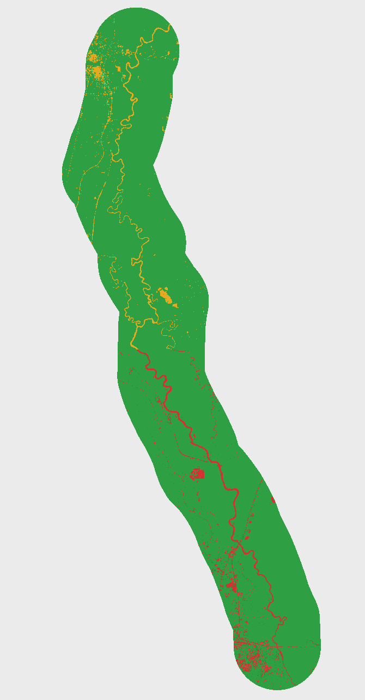

# Trust map: when NISAR flooded-forest maps can be relied on

**Code:** `src/hidden_floods/trust.py` and `scripts/build_trust_map.py`.
**Outputs** (in `outputs/trust/`):
- `trust_table.json` and `trust_table.md`;
- one GeoTIFF per pair, with values 1 green, 2 amber, 3 red, 4 insufficient data, and 0 outside the corridor.

**Detector:** the frozen v2 rule (`freeze_receipt_v2.json`) on all six NISAR pairs:
- development: Isaias 076A and 127D, Pearl 105A and 156D;
- held out: Tangipahoa 105A and 156D.

**Truth:** gauges plus lidar, with the 10 km gauge-support rule and permanent water excluded.

**Conditions.** All are known *at mapping time, without truth*:
- **flood timing** at the nearest gauge: rising, near crest (0–2 days after the crest), receding (2–6 days), late recession (more than 6 days);
- **land cover** (ESA WorldCover 2021, 10 m);
- **incidence angle** (GCOV radar-grid cube).

**Trust rule:**
- **green:** CSI ≥ 0.5 *and* 95% CI lower bound ≥ 0.25;
- **red:** CSI < 0.25;
- **amber:** otherwise;
- **insufficient data:** under 150 ha of flooded truth.

## Pooled behaviour (all six pairs; development pairs are in-sample)

| Flood timing | Flooded truth (ha) | CSI (95% CI) | Recall | Precision | Trust |
|---|---|---|---|---|---|
| Rising | 12,021 | 0.59 (0.43–0.73) | 0.61 | 0.96 | green |
| **Near crest** | 12,030 | **0.81 (0.75–0.87)** | 0.88 | 0.91 | green |
| Receding | 17,706 | 0.50 (0.41–0.58) | 0.66 | 0.66 | amber |
| Late recession | 6,352 | 0.21 (0.10–0.33) | 0.41 | 0.31 | **red** |

| Land cover | Flooded truth (ha) | CSI (95% CI) | Trust |
|---|---|---|---|
| Tree cover | 46,598 | 0.54 (0.47–0.61) | green |
| Other | 1,347 | 0.32 (0.25–0.39) | amber |
| Crop/grass/shrub | 147 | 0.03 | too little truth (precision 0.03: farmland false alarms) |
| Herbaceous wetland | 17 | 0.27 | too little truth |

| Incidence | Flooded truth (ha) | CSI (95% CI) | Trust |
|---|---|---|---|
| < 38° | 18,766 | 0.72 (0.61–0.81) | green |
| 38–42° | 20,022 | 0.43 (0.34–0.50) | amber |
| 42–46° | 9,320 | 0.47 (0.32–0.60) | amber |

**Best cell: near crest in tree cover, CSI 0.82 (0.76–0.88)**, with 11,666 ha of flooded truth. **Worst: late recession in tree cover, CSI 0.22 (0.10–0.34).** Flood timing is the strongest factor. The incidence pattern (steeper is better) matches the known weakening of double bounce at shallow angles. It is partly confounded with which pairs fall in each bin.

## Does it hold up for a flood it wasn't built on? (leave one flood out)

For each flood, the timing × land-cover table was rebuilt without that flood, then used to paint it. Each class was scored on that flood.

| Held-out flood | Green CSI | Amber CSI | Red CSI |
|---|---|---|---|
| Choctawhatchee | **0.79** (3,026 ha) | 0.41 (5,950 ha) | 0.58 (403 ha) |
| Pearl | **0.65** (17,986 ha) | 0.12 (148 ha) | 0.39 (6,096 ha) |
| Tangipahoa | **0.27** (2,279 ha) | 0.07 (118 ha) | 0.01 (81 ha) |

For Pearl, its rising-limb pixels had no training data from other floods, so they were classed "insufficient data". They scored CSI 0.59.

**Honest reading:**
- **The ranking mostly transfers.** On every held-out flood, green pixels scored best, by a wide margin over amber at all three rivers.
- **The absolute level does not.** Green on the Tangipahoa scored only 0.27, because its receding-limb forest behaved worse than the other floods'.
- **Red isn't always worst.** On the Choctawhatchee, red (403 ha) scored better than amber.

So the trust map says **where a NISAR flood map is *more* trustworthy than elsewhere in the same scene**. It does not guarantee a given accuracy.

## How to use it in the pitch

- **Show it as a traffic-light overlay:** "Trust this map most where the river is near its crest and the floodplain is forested; treat late-recession and farmland detections as uncertain."
- **Back it with the leave-one-flood-out table:** green beat the rest on all three held-out floods, and the absolute accuracy is event-specific.
- **Don't** present green as "82% accurate". That figure is in-sample.

